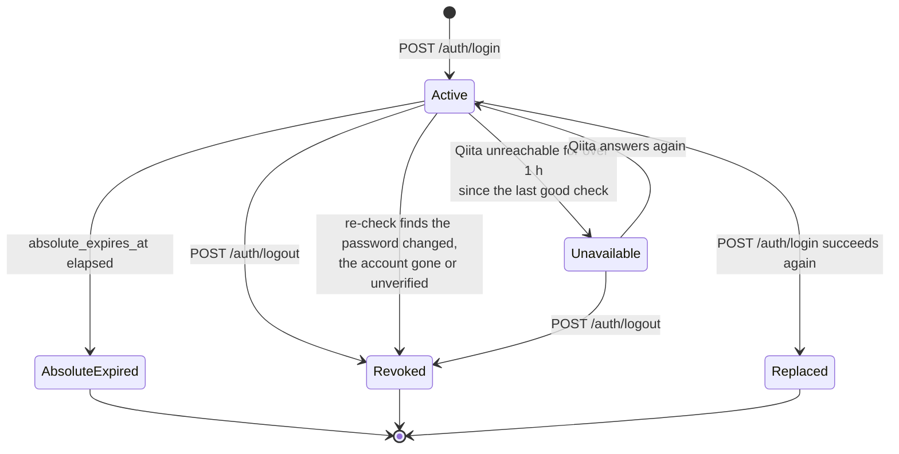

# 02 — Authentication

*How a browser becomes an authenticated `g.user_id`, why the design is shaped this way, and every way it can fail.*

Prerequisites: [`01-architecture.md`](01-architecture.md) — the request lifecycle and the two `before_request` hooks.

---

## Why classic-Qiita email + password

Users sign in with the **email and password of their classic-Qiita account** (qiita.ucsd.edu). QiitaExplore checks them itself, against `qiita.qiita_user` in classic Qiita's production PostgreSQL, through the same read-only role it already uses for every study read. There is no HTTP call to Qiita, no redirect and no callback. Sign-up, email verification and password reset stay on classic Qiita (`QIITA_CLASSIC_URL`, default `https://qiita.ucsd.edu`); the sign-in form links there. QiitaExplore's role cannot write to `qiita_user`.

Until 2026-10-12 the login was different: a user signed in on the qiita-miint control plane, copied the `qk_` token it showed, and pasted it into QiitaExplore, which checked it once with `whoami`. That flow is gone, along with the control plane dependency, the AuthRocket/LoginRocket workaround and the legacy `"default"` claim (see [Removed](#removed)).

Why this shape:

- **One system to trust.** Identity and data now come from the same classic Qiita database, so "who is this user" and "what studies exist" can't disagree about which Qiita they mean.
- **Not Qiita's OAuth2 password grant.** `qiita_db/handlers/oauth2.py` would give QiitaExplore a token without handling the password itself, but it issues tokens to **unverified** users, needs Qiita's web server and Redis to be up, and its tokens are unscoped. Reading the table directly is smaller and checks the same thing.
- **The check matches classic Qiita's own.** `User.login` (`qiita_db/user.py`) re-hashes the typed password with the stored bcrypt hash as salt and refuses user level 5 (`unverified`). QiitaExplore does the same compare (see [Matching classic Qiita's check](#matching-classic-qiitas-check)).

The cost is that QiitaExplore now handles real Qiita passwords. Read [the threat model](#threat-model-stated-plainly) before changing anything on the login path or the deployment in front of it.

---

## The login flow


### The checks, in order

`backend/routes/auth_routes.py :: api_auth_login`. Every check fails closed. The first one that fails answers; nothing after it runs.

| # | Check | On failure | Counted toward a limit? |
|---|---|---|---|
| 1 | **Body size.** `Content-Length` over 8 KB. | **413** `request too large`, before parsing. | No |
| 2 | **JSON only.** The request must be `application/json`. A cross-site HTML form can't send that content type, so this stops form-based login CSRF. | **415** `JSON body required` | No |
| 3 | **Origin.** `Origin` must exactly equal `QIITA_EXPLORE_PUBLIC_ORIGIN` or one entry of `QIITA_EXPLORE_ALLOWED_ORIGINS` (dev). If `Sec-Fetch-Site` is sent, it must be `same-origin` (`same-site` too, but only for a dev origin from `QIITA_EXPLORE_ALLOWED_ORIGINS`: a sibling subdomain of the public site is same-site). | **403** `origin not allowed`. With neither setting configured, login refuses outright: **503** `Login is not configured on this server.` | No |
| 4 | **Bounded read, then a JSON object.** The body is read with a hard limit of 8 KB + 1 bytes, so a chunked body (no `Content-Length` for step 1 to check) can't run past it either. | Over 8 KB: **413**. Not a JSON object: **415**. | No |
| 5 | **Format.** Email: strip; reject over 254 characters, non-ASCII (checked *before* lowercasing, so the Kelvin sign can't become `k`), or not exactly one `@`; then lowercase. Password: classic Qiita's rule (8+ characters, ASCII, no space, no backslash) plus QiitaExplore's own 1024-character cap. | **401** with the generic text. Nothing is written. | **No** — no bcrypt work was done |
| 6 | **Limits** — see [Brute-force limits](#brute-force-limits-built-not-to-lock-people-out). The attempt is reserved *before* any bcrypt work. | **429** with `Retry-After` and `retry_after`, text "Too many attempts — try again in N minutes." Limiter file unusable: **503**. | It *is* the count |
| 7 | **Account and password.** Read the account; compare the password. | Unknown email: a dummy bcrypt check of the same cost, then **401**. Wrong password: **401**, same text. Database down or circuit open: **503** `Qiita's user database is unreachable — try again shortly.` This worker already busy with a bcrypt check for 0.5 s: **503** with `Retry-After: 2`. | Yes (reserved at step 6) |
| 8 | **Unverified.** Level id 5, or level name `unverified`. Only checked *after* the right password, so it reveals nothing to a guesser. | **403** `Verify your email on Qiita first.` (`"unverified": true`). No session. | Yes |
| 9 | **Success.** | — | Clears this email's counter, and takes its own attempt back off the client's |

The generic 401 text is `Incorrect email or password.` for an unknown email, a wrong password and a malformed attempt alike.

On success, in this order: the limiter clears the **per-email** counter, takes this attempt back off the client's failure count, and remembers this browser for this account (a new known-device cookie, unless the browser already has a valid one); `purge_expired_sessions()` runs; `resolve_user` finds or creates the account ([Identity](#identity-migration-and-binding-old-accounts)); `create_session` mints a fresh token and, if the browser already held a session, revokes that one in the same transaction. A failed login leaves the current session untouched. The response is `{user_id, email, level, csrf_token}`.

**The password is never logged, stored, put in an error, or echoed back.** `test_auth.py :: test_password_never_logged_or_stored` checks the logs and the SQLite, `-wal` and `-journal` files.

### Matching classic Qiita's check

`backend/helpers/qiita_accounts.py`:

- **The compare.** `bcrypt.checkpw` (constant time) on the **first 72 bytes** of the UTF-8 password, against the stored hash. bcrypt 4.x truncates at 72 bytes, as classic Qiita does; bcrypt 5 raises instead, so the requirements pin `bcrypt<5` (`==4.3.0` in production).
- **A stored hash that isn't bcrypt** (not `$2a$` / `$2b$` / `$2y$` with 53 hash characters) returns False after the same work as a real check, and logs a warning without the email.
- **Same cost for unknown and wrong.** An unknown email gets a check against a dummy cost-12 hash (made lazily, once per worker), so timing does not reveal whether an account exists.
- **One check at a time per worker.** A `Semaphore(1)`: a second login on the same worker waits at most 0.5 s, then gets the 503 above. A login flood can't take both of a worker's request threads, and there is no global lockout.

### Reading accounts

`fetch_account` runs one query (`qiita.qiita_user JOIN qiita.user_level`, exact match on the normalized email) through **its own pool**, separate from `helpers/pg_pool.py`, with the same credentials (`QIITA_CONFIG_FP`):

| Setting | Value |
|---|---|
| Pool | `ThreadedConnectionPool(2, 4)` per worker: two connections (one per gunicorn thread) stay open for reuse; psycopg2 closes any returned beyond that. |
| Timeouts | `connect_timeout=5`, `statement_timeout=5000` ms, TCP keepalives |
| Transactions | `default_transaction_read_only=on`; each lookup rolls back its read |
| Circuit breaker | 3 consecutive failures open it; it fails fast (`AccountsUnavailable`) for 30 s |

A silent Postgres therefore can't pin the login path or the per-request re-check below.

---

## Brute-force limits, built not to lock people out

Classic Qiita has no rate limit, and its login page says whether an account exists ("Unknown user" vs "Incorrect password"). Anyone can guess against qiita.ucsd.edu directly. QiitaExplore's limits therefore don't really protect the password. They protect QiitaExplore's availability (bcrypt CPU, Postgres connections), and they are designed so that they can't be turned into a way to lock a real user out.

`backend/helpers/login_limiter.py`:

| Key | Rule | Why this shape |
|---|---|---|
| **Per email** | The first 5 attempts in 15 minutes are free. Each attempt after that must wait 2^(n−5) seconds (2, 4, 8, …), at most 5 minutes. Cleared by a successful login. | A progressive delay, not a lock: an attacker who knows someone's email can slow the account down, never shut it. |
| **Per client** | 30 **failed** attempts in 15 minutes block that client for 15 minutes. A success takes its own attempt back off the count (and lifts a block that attempt set). **Only when `QIITA_EXPLORE_CLIENT_IP_HEADER` is set.** | Behind the SSH tunnel every request arrives from 127.0.0.1, so a per-IP limit without a trusted header would be a global lockout. Counting failures only keeps a busy shared network (campus NAT) from blocking itself by logging in. |
| **Known device** | A browser that has logged into an account gets a random device cookie (`__Host-qe_dev`, 30 days, refreshed on each login). From that browser, that account skips **both** limits above. A device gets 10 attempts in a row without a success; after that the normal limits apply to it too, and its next success replaces the cookie. Only the token's SHA-256 is stored, next to the email's hash. | The real user's usual browser gets in even while someone hammers their email or shares their IP (OWASP's device-cookie pattern), and a stolen device cookie buys at most 10 guesses before the normal limits apply. |
| **Concurrency** | The per-worker bcrypt semaphore: 503 with `Retry-After`, never a lock. | — |
| **Edge** | A Cloudflare rate-limiting rule on `POST /api/auth/login` (deploy step, [`../DEPLOYING.md`](../DEPLOYING.md)). | Cloudflare sees the real client IP, which the backend can't by itself. |

How it is stored and counted:

- **Every reserved attempt counts** — unknown email, wrong password, unverified — and is counted *before* bcrypt, inside one `BEGIN IMMEDIATE` read-modify-write, so parallel requests can't slip past the count. An attempt made with a valid device cookie counts only against that device. Malformed attempts (step 5) never reach the limiter.
- **Its own SQLite file**, `QIITA_EXPLORE_LIMITER_DB` (default: a per-user folder under the system temp directory, `qiita_explore-<uid>/login_limiter.db`): on local disk, not the shared `projects.db` on `/ddn_scratch`, so login writes never contend with chat writes. Busy timeout 1 s. Barnacle is multi-user, so the file and its folder must be owned by the backend's user and not group- or world-writable (the folder is created `0700`, the file set to `0600`): a planted or shared file could hand out device rows — unlimited guesses — or wipe the counters. If the file can't be used, login answers **503** — it fails closed. Two tables, `attempts` and `devices`; see [`appendix-b-sqlite-schema.md`](appendix-b-sqlite-schema.md#the-login-limiter-file).
- **No raw emails or IPs on disk.** Keys are `e:` + SHA-256 of the normalized email, or `c:` + SHA-256 of the client IP.
- **Pruned on write**, on about one reservation in fifty: attempt rows older than 24 hours that aren't blocking anything, and expired devices.
- **The client IP** comes only from the configured header: its **last** comma-separated entry (the one the trusted proxy wrote; earlier entries are whatever the client sent), parsed as an IP address. Set it only once the proxy chain guarantees it can't be forged ([`../DEPLOYING.md`](../DEPLOYING.md)).

---

## Sessions

`create_session` generates a 32-byte URL-safe token, stores `SHA-256(token)` as the primary key, and returns the plaintext exactly once, for the cookie. Anyone with read access to the SQLite file — a backup, a stray copy — cannot replay a session. It also stores a 32-byte CSRF token, and `password_fp`: SHA-256 of the account's bcrypt hash at login.

### Cookies

`_cookie_kwargs` in `backend/routes/auth_routes.py`, names in `backend/config.py`:

| Cookie | Name (Secure on / plain-HTTP dev) | Attributes | Lifetime |
|---|---|---|---|
| Session | `__Host-qe_sid` / `qe_sid` | `HttpOnly`, `SameSite=Lax`, `Secure` per `QIITA_EXPLORE_COOKIE_SECURE`, `path=/`, no `Domain` | `AUTH_SESSION_ABSOLUTE_TTL_SECONDS` (24 h) |
| Known device | `__Host-qe_dev` / `qe_dev` | same | 30 days, refreshed on each login from that browser |

`QIITA_EXPLORE_COOKIE_SECURE` defaults to on. With it on, the names carry the `__Host-` prefix, which the browser only accepts on a `Secure`, host-only cookie with `path=/` — so a sibling subdomain of the deployment's domain can't plant or overwrite the session cookie. Plain-HTTP loopback dev turns Secure off and gets the bare names.

### Following Qiita: the re-check

A session ends at its 24-hour ceiling, at logout, when the user signs in again — and when the account changes on Qiita.



On any request whose `last_verified_at` is more than **5 minutes** old, `_load_session` re-reads the account (`helpers/auth_middleware.py :: _still_valid`). The session is revoked when:

- the account no longer exists;
- it is unverified;
- the stored `password_fp` doesn't match SHA-256 of the current hash (`hmac.compare_digest`) — the password was changed or reset on Qiita;
- the session has no `password_fp`, or its account has no bound `qiita_email`.

A valid answer sets `last_verified_at` to now. A password changed on Qiita therefore logs QiitaExplore out on the first request after the 5-minute mark.

**When Qiita's database can't be read**, the session is **not** revoked. It keeps being served for up to **1 hour** after its last good check (each request in that window tries again; the circuit breaker keeps that to one probe per 30 s per worker once it opens). After the hour, every request on that session — public endpoints included — gets **503** with `Retry-After: 30`, until Qiita answers again. The one exception is `POST /api/auth/logout` (with its CSRF header): logging out only revokes a local session, so it always works. That fails closed without logging everyone out on a short blip.

| Bound | Default | Where | Extended by activity? |
|---|---|---|---|
| Absolute expiry | 24 hours | `AUTH_SESSION_ABSOLUTE_TTL_SECONDS` | **No** — hard ceiling |
| Qiita re-check | every 5 minutes | `auth_middleware.RECHECK_SECONDS` | — |
| Outage grace | 1 hour since the last good check | `auth_middleware.RECHECK_GRACE_SECONDS` | — |

There is no idle expiry. `touch_session` updates `last_seen_at` only, at most every 5 minutes, and never extends `absolute_expires_at`.

**Session growth.** `purge_expired_sessions` runs on every successful login. It deletes rows past absolute expiry and revoked rows older than 7 days (kept that long for audit). Nothing else runs it, so with no logins nothing is purged (TKT-056).

---

## The middleware

Two `before_request` hooks in `backend/helpers/auth_middleware.py`. Flask short-circuits the chain the moment one returns a non-`None` value.

### Hook 1 — `_load_session`

Resolves the cookie to an identity. `get_session_by_token` rejects a session that is missing, revoked, or past its absolute expiry. If it survives, the Qiita re-check above runs when due, then `touch_session`, then `g.user_id` and `g.session_row` are set.

### Hook 2 — `_require_auth`

```python
if g.get("auth_unavailable") and not logout:  return 503   # Qiita unreachable past the grace hour
if request.endpoint in PUBLIC_ENDPOINTS:      return None  # allowlisted
if request.endpoint is None:                  return None  # unknown route → Flask 404
if g.get("user_id") is None and not logout:   return 401
if request.method in _STATE_CHANGING_METHODS:              # POST/PUT/PATCH/DELETE
    if not hmac.compare_digest(csrf_header, expected): return 403
```

(`logout` is shorthand for "this is `api_auth_logout` on a session past the outage grace" — see above.)

**The allowlist matches exact Flask endpoint names, never path prefixes.** It contains exactly two entries: `api_auth_login` and `api_auth_me`. A prefix like `/api/auth/` would silently make every future route under that path public. With exact names, **a newly added route is denied by default**, and making it public requires a deliberate edit to this set. `POST /api/auth/logout` is not public: it needs a session and the CSRF header.

Of 74 routes, 2 are public.

CSRF uses `hmac.compare_digest`, so the comparison is constant-time. The token travels in the login (or `/auth/me`) response *body*, not a cookie, into a JavaScript module variable, and is attached as `X-CSRF-Token` by the shared fetch wrapper on state-changing methods only. A cross-site page can make the browser send the `SameSite=Lax` cookie on a top-level POST but cannot read the response body that carries the token.

---

## What is stored, and what never is

| Where | What |
|---|---|
| `users` (`projects.db`) | `user_id`; `qiita_email` (normalized, `UNIQUE`; `NULL` until bound); `user_level`; `principal_idx` / `miint_email` (qiita-miint accounts only); timestamps. See [`appendix-b-sqlite-schema.md`](appendix-b-sqlite-schema.md#table-users). |
| `auth_sessions` (`projects.db`) | SHA-256 of the session token, the CSRF token, `password_fp`, `source = 'qiita-classic'`, timestamps, `revoked_at`. |
| Limiter file | Attempt counters keyed by SHA-256 of an email or client IP; device rows holding SHA-256 of the device token and of the email. |

**Never stored:** the password; the bcrypt hash (only its SHA-256, which hides the salt and so is useless for cracking); the raw session or device token; a raw email or IP in the limiter.

---

## Identity, migration and binding old accounts

**`user_id` is QiitaExplore's own id, bound to one classic-Qiita email.** `store/auth_store.py :: resolve_user` returns the `user_id` of the row whose `qiita_email` matches, so that account's projects, chats, workspaces and jobs carry over. With no match it creates a new account with an opaque id, `"q"` + 16 hex characters. Two concurrent first logins for the same email: the loser's `INSERT` hits the `UNIQUE` constraint and re-reads the winner's row. `user_level` and `last_login_at` are refreshed on every login.

**The migration.** `store/db.py :: _migrate_users_to_classic` runs once at boot (via `start_barnacle.sh`'s bootstrap and each worker's import) and rebuilds a qiita-miint-era `users` table into the shape above:

- every existing row keeps its `user_id` (all its data hangs off it), `principal_idx` and timestamps; its qiita-miint email moves to `miint_email`; `qiita_email` starts `NULL`;
- every live session is revoked — they were all qiita-miint sessions;
- it uses its own autocommit connection, turns foreign keys off *before* the transaction (and aborts unless that took), and takes `BEGIN IMMEDIATE`, so exactly one gunicorn worker migrates and the rest find it done;
- it builds `users_new`, drops `users`, and renames `users_new` into place. (Renaming the old table aside instead would rewrite `auth_sessions`' foreign key to point at it.) A non-empty `PRAGMA foreign_key_check(auth_sessions)` (the only table that references `users`) rolls everything back;
- it records `meta.users_classic_v1`. It detects "already done" by the `qiita_email` column, so a second boot is a no-op. A crash before `COMMIT` leaves the old table untouched.

A dry run on a copy of the production database (2026-10-12) kept all 4 users (qiita-miint email moved to `miint_email`, `qiita_email` `NULL`), kept 11 sessions but revoked them, left the foreign-key check empty and the integrity check ok, and changed nothing on a second boot.

The older boot hook `_reconcile_legacy_users_table` — which moves aside a *pre-authentication* `users` table — now detects that table positively, by its `username` / `password_hash` columns. It used to test for a missing `principal_idx`, which would have mistaken any later schema for the pre-auth one.

**Binding is explicit, never automatic.** qiita-miint never proved its users owned their emails, so binding on email alone could hand someone's workspaces to whoever holds that address on classic Qiita. An operator binds each old account with `qiita_explore/scripts/bind_classic_accounts.py`:

- **Dry run** (the default) lists every account: `user_id`, `principal_idx`, `miint_email`, and whether a classic account exists for that email and its level. Nothing changes.
- **`--apply <user_id>=<email> …`** binds only the listed pairs, and only when a **verified** classic account exists for the email right now, the account is still unbound, and the email isn't bound to another account.

Run it **before** that person's first classic login. A first login creates a new, empty account bound to their email, after which the script can't bind the old account to it. The deploy steps are in [`../DEPLOYING.md`](../DEPLOYING.md).

**Legacy `"default"` data.** The claim routes and `store/legacy_claim.py` are gone. Rows still owned by the literal user `"default"` stay in the database, owned by no one who can log in.

---

## Removed

As of 2026-10-12:

- **Routes:** `POST /api/auth/connect`, `GET /api/auth/login-url`, `GET /api/auth/legacy-default`, `POST /api/auth/claim-default` (all now 404), and `POST /api/settings` (TKT-042, below).
- **Code:** `helpers/qiita_client.py` (`whoami`), `store/legacy_claim.py`, and the `system_role`, `scopes`, `profile_complete` and `claim_eligible` fields of the identity payload (now `email` and `level`).
- **Configuration:** `QIITA_CONTROL_PLANE_URL`, `QIITA_PUBLIC_LOGIN_URL`, `QIITA_LOGINROCKET_URL`, `QIITA_WHOAMI_TIMEOUT_SECONDS`, `QIITA_DEFAULT_DATA_CLAIMANT_PRINCIPAL_IDX`, `QIITA_EXPLORE_DEBUG_ERRORS` — see [`appendix-d-configuration.md`](appendix-d-configuration.md).
- **Requirements:** the direct `httpx` and `cryptography` pins; `bcrypt` added.
- **Frontend:** `ConnectQiita`, `LegacyClaimBanner`, and the Anthropic-key prompt in the model picker.

---

## Tenancy: `g.user_id` is the only identity

This is the guarantee that keeps users' data separate, and it is worth stating precisely.

`g.user_id` is set once, by the middleware, from the session row. Handlers read it directly and pass it into store functions that filter on it **in the WHERE clause** — `get_project(project_id, g.user_id)`, `get_global_chat(g.user_id, chat_id)`, `get_workspace(workspace_id, g.user_id)`, `get_merge_job(job_id, g.user_id)`.

**No endpoint accepts a client-supplied `user_id`** — not in a body, a query parameter, a path segment, or a header. There is no code path where the browser can assert who it is. Ownership is enforced by scoping the query, not by fetching a row and checking it afterward, so a wrong-owner request returns "not found" rather than leaking existence.

Two caveats to be aware of:

- `backend/store/crud.py :: get_project_studies_only` is **not owner-scoped**. It is used in the hot chat-streaming path, where the caller has already authorized the project. It is safe as currently called and would be an IDOR if called from a new route without a prior ownership check.
- `backend/store/db.py :: _resolve_user` maps an empty or `None` user to the literal string `"default"`, the pre-authentication owner. It should never trigger on a request path, because the middleware guarantees `g.user_id` is set — but the fallback remains reachable from any caller that passes nothing (TKT-049).

### Signed in is not the same as allowed to read private data

Any **verified** classic-Qiita account can log in, at every user level — and anyone can create a Qiita account and verify an email. QiitaExplore does not resolve a user's per-study Qiita permissions. A session proves "this is a verified Qiita user", never "this user may see study X". So every path that reads Qiita data serves **public data only**.

Study-level reads already gate on `is_study_public` (a study is public when it has at least one public artifact). **TKT-043** (fixed 2026-10-12) adds the artifact-level rule, because visibility is per artifact — a public study can still hold private, sandboxed or archived artifacts:

- `helpers/qiita_fetch.py :: public_artifact_ids(study_id)` reads the study's public artifact ids **live** from Qiita, because the study-detail cache's copy of per-artifact visibility can be hours stale. It is empty when the study isn't public, and on a failed read (fails closed).
- `helpers/merge_helpers.py :: public_artifacts(study_id)` returns the artifact-graph nodes for exactly those ids (the cached graph supplies the file lists; it is fetched again if missing or stale). `_get_artifacts` filters the flat artifact list to the same ids. Everything that reads BIOM files or sample lists goes through it: `GET /api/artifacts/<id>/samples`, `POST /api/artifacts/sample-counts`, and merge workspaces (validate, workspace samples, per-study samples, job submission).
- `routes/artifact_routes.py :: _resolve_artifact_file` (file download) looks the artifact up in `public_artifacts`, so a private artifact or a private study's artifact gets **403** `Artifact … not found or not public in study …`.
- The sequence-file query in `helpers/fastq_manifest.py` (`_FILES_FROM`) only joins public artifacts. It backs `GET /api/artifacts/<id>/fastq-manifest` (which also requires a public study), the Sample Aggregation export, and the aggregation's per-sample file map.
- `GET /api/studies/<id>/detail` (`helpers/study_detail.py`) still shows a public study's non-public artifacts in the chart, but with their file paths removed (`full_path` `null`, `filepaths` empty).
- `routes/merge_routes.py :: add_study_to_merge_workspace` refuses a non-public study with **404** `Study not found or not public`.

Not yet covered: a public study's **private preps** still show their metadata and sample membership through `GET /api/studies/<id>/sample-preps`, `GET /api/studies/<id>/preps/<prep_id>/samples` and the detail's `preps` list (TKT-105, Low).

The download's path safety is separate and unchanged: `_resolve_artifact_file` resolves paths from the artifact graph rather than from user input, calls `os.path.realpath`, and rejects a **blocklist** of roots (`/etc/`, `/proc/`, `/sys/`, `/dev/`, `/root/`).

**TKT-042** (fixed 2026-10-12) — the Anthropic key was a single shared setting that any user could overwrite. `POST /api/settings` is removed, so the key can no longer be set from a browser. `GET /api/settings` reports whether a key exists — one stored in the `meta` table before this change, or `ANTHROPIC_API_KEY` in the server's `.env` — and the model picker disables the Claude models ("not configured on this server") when there is none. A key already in `meta` still takes precedence over the env var (`config.py :: get_client`). Per-user keys are a separate ticket.

---

## Threat model, stated plainly

**Where the password can be read in plaintext.** The production path is browser → Cloudflare → Caddy on kl-remote → SSH tunnel → gunicorn on barnacle ([`../DEPLOYING.md`](../DEPLOYING.md)).

- **Cloudflare.** TLS from the browser ends at Cloudflare's edge, so Cloudflare sees every password.
- **Anyone with the `kl-user` account on kl-remote.** That account runs Caddy, which handles the request in plaintext before it enters the tunnel; whoever controls it can log or redirect the body.
- **Barnacle's gunicorn processes**, which must read it to check it.

This covers **admin-level Qiita accounts too**: every verified level may log in. Encrypting the Cloudflare → kl-remote hop is a deploy prerequisite; it removes a network eavesdropper on that hop, not the parties above.

**QiitaExplore reads every bcrypt hash.** Its read-only Postgres role can `SELECT` all of `qiita.qiita_user`, so whoever holds that role's credentials (`QIITA_CONFIG_FP` on barnacle) can copy every hash and crack them offline. The role had that access before this change; now QiitaExplore's code reads hashes routinely. The fix is a `SECURITY DEFINER verify(email, password)` function on the Qiita side, so the role checks passwords without reading hashes (TKT-100).

**Guessing.** Classic Qiita has no rate limit and reveals whether an account exists, so QiitaExplore's limits don't protect a password from online guessing; they protect QiitaExplore. QiitaExplore itself reveals nothing: unknown and wrong answer identically, with the same bcrypt cost, and "unverified" is only said after the right password.

**Upstream.** Classic Qiita's OAuth2 password grant issues tokens to unverified users, and `/qiita_db/user/<id>/data/` returns password hashes. Both are notes for the Qiita maintainers, not QiitaExplore code (TKT-101).

---

## What this design does and does not defend against

Stated plainly, without overclaiming.

**Defends against:**

- Session token theft from the database at rest — only hashes are stored.
- Password disclosure from QiitaExplore's own storage or logs — passwords are never stored or logged, and only a SHA-256 of the bcrypt hash is kept.
- CSRF on state-changing requests — a constant-time-compared header token that a cross-site page cannot read.
- Login CSRF — JSON only, plus an exact `Origin` match.
- A new endpoint accidentally shipping unauthenticated — default deny by exact endpoint name.
- Horizontal privilege escalation on curational data (projects, chats, workspaces, jobs) — every ownership query filters on `g.user_id`.
- A session outliving a password change, account deletion or un-verification on Qiita — for more than about 5 minutes.
- Learning from QiitaExplore whether a Qiita account exists — identical 401s and timing.
- Login floods taking QiitaExplore down, or an attacker keeping a user out of their usual browser — per-worker bcrypt limit, circuit breaker, progressive delay, known-device cookie.
- A sibling subdomain planting a session cookie — the `__Host-` prefix.
- A signed-in user reading private studies' artifacts, or replacing the shared Anthropic key — TKT-043 and TKT-042.
- A changed CDN script — the five CDN scripts carry SRI hashes and fail to load if their content changes ([`08-frontend.md`](08-frontend.md)).

**Does not defend against:**

- Cloudflare, or anyone with the `kl-user` account on kl-remote, reading passwords — see the threat model.
- Anyone holding QiitaExplore's Postgres credentials reading every bcrypt hash.
- Online guessing against classic Qiita directly.
- XSS. The CSRF token lives in a JS variable, and the page's CSP allows `'unsafe-eval'` and inline script (Babel standalone needs both), so the CSP does not stop injected script. Its `connect-src` keeps `fetch`/XHR on the page's own origin, but injected script could still carry a password away by navigating. The real protections are the pinned, SRI-checked scripts and DOMPurify on model output ([`08-frontend.md`](08-frontend.md)); if DOMPurify fails to load, model output is shown escaped rather than as HTML.
- Framing (clickjacking), until the proxy sends `frame-ancestors 'none'` as a response header — browsers ignore it in the page's meta CSP ([`../DEPLOYING.md`](../DEPLOYING.md)).
- A session continuing for up to 5 minutes after a password change on Qiita, or up to an hour while Qiita's database is unreachable.
- Per-client guessing limits, until a trusted client-IP header is configured — and even then, any account on barnacle2 can reach gunicorn on `127.0.0.1` and forge that header.
- Cost abuse: every verified Qiita user can run the shared LLMs and the in-process merge executor, with no per-user quota (TKT-104).
- An attacker who can read process memory during login.

---

*See also: [`appendix-a-api-reference.md`](appendix-a-api-reference.md#auth) for the 3 auth endpoints · [`appendix-b-sqlite-schema.md`](appendix-b-sqlite-schema.md#table-auth_sessions) for the `users` and `auth_sessions` tables and the limiter file · [`appendix-d-configuration.md`](appendix-d-configuration.md#authentication) for the auth variables · [`08-frontend.md`](08-frontend.md) for the browser-side state machine · [`../DEPLOYING.md`](../DEPLOYING.md) for the deploy prerequisites.*
