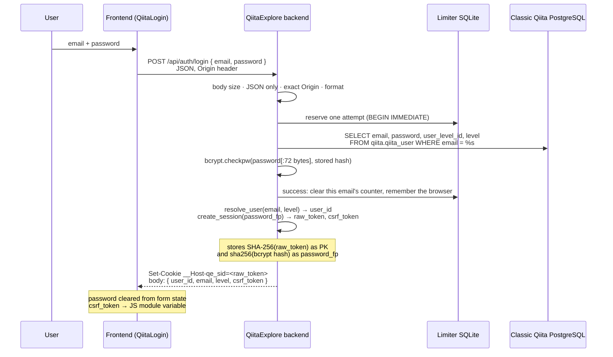
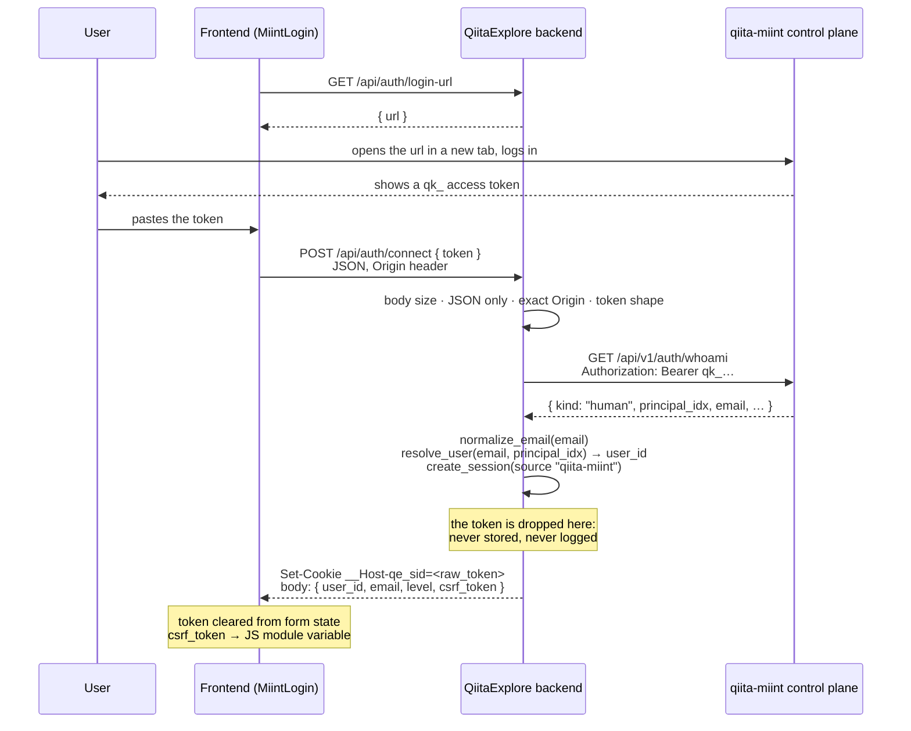
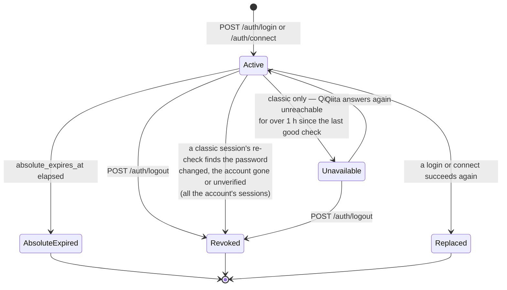

# 02 — Authentication

*How a browser becomes an authenticated `g.user_id`, why the design is shaped this way, and every way it can fail.*

Prerequisites: [`01-architecture.md`](01-architecture.md) — the request lifecycle and the two `before_request` hooks.

---

## Two ways in, one account per email

The login page offers two ways to sign in, as equal cards side by side (stacked on a narrow screen):

| | Classic Qiita | qiita-miint |
|---|---|---|
| The user gives | the email and password of their classic-Qiita account (qiita.ucsd.edu) | a `qk_` access token, copied from the qiita-miint login page |
| QiitaExplore checks it | itself, against `qiita.qiita_user` in classic Qiita's PostgreSQL (bcrypt) | once, with qiita-miint's `whoami` on the control plane |
| Route | `POST /api/auth/login` | `POST /api/auth/connect`, plus `GET /api/auth/login-url` for the page that issues the token |
| Session `source` | `qiita-classic` | `qiita-miint` (production's sessions from before 2026-10 say `paste`) |
| After sign-in | re-checked against classic Qiita every 5 minutes; a failed re-check ends every session of the account | not re-checked; lasts to its 24-hour ceiling (or until a classic re-check of the same account fails) |
| Brute-force limits | yes | none (a token can't be guessed); one `whoami` per worker at a time, and a circuit breaker |

**Both reach the same account for the same email.** A QiitaExplore account is an opaque `user_id`, which owns all its data (projects, chats, workspaces, aggregations, jobs), plus the normalized email that both logins resolve through. Sign in with classic Qiita as `someone@ucsd.edu`, or with a qiita-miint token whose account reports `someone@ucsd.edu`, and you reach the same `user_id`. Accounts are matched by email only. Different emails are different accounts, and nothing links them — not even the same qiita-miint principal after an email change. The whole address must match, so `d4sharma@ucsd.edu` and `d4sharma@eng.ucsd.edu` are two accounts. The login page says it in one line: "Same email, same account: either way, your workspaces, chats and aggregations are there." See [One account per email](#one-account-per-email).

**Either method can be switched off.** `QIITA_EXPLORE_LOGIN_METHODS` (default `classic,miint`) lists the enabled methods. An empty or unknown value raises at import, so the backend won't start without a usable login. A disabled method's routes answer **404** before any other check, `GET /api/auth/me` reports the enabled methods as `login_methods`, and the login page shows only their cards. A session made by a disabled method is revoked on its next request (`qiita-classic` → classic; `qiita-miint` and production's older `paste` → miint), so switching the method back on doesn't bring it back — a method is most likely switched off because something went wrong with it.

Until 2026-10 the qiita-miint token was the only way in, so every production account and session so far comes from it ([The migration](#the-migration)).

### Why classic-Qiita email + password

QiitaExplore checks the email and password itself, against `qiita.qiita_user` in classic Qiita's production PostgreSQL, through the same read-only role it already uses for every study read. There is no HTTP call to Qiita, no redirect and no callback. Sign-up, email verification and password reset stay on classic Qiita (`QIITA_CLASSIC_URL`, default `https://qiita.ucsd.edu`); the sign-in form links there. QiitaExplore's role cannot write to `qiita_user`.

Why this shape:

- **One system to trust.** For a classic login, identity and data come from the same classic Qiita database, so "who is this user" and "what studies exist" can't disagree about which Qiita they mean.
- **Not Qiita's OAuth2 password grant.** `qiita_db/handlers/oauth2.py` would give QiitaExplore a token without handling the password itself, but it issues tokens to **unverified** users, needs Qiita's web server and Redis to be up, and its tokens are unscoped. Reading the table directly is smaller and checks the same thing.
- **The check matches classic Qiita's own.** `User.login` (`qiita_db/user.py`) re-hashes the typed password with the stored bcrypt hash as salt and refuses user level 5 (`unverified`). QiitaExplore does the same compare (see [Matching classic Qiita's check](#matching-classic-qiitas-check)).

The cost is that QiitaExplore now handles real Qiita passwords. Read [the threat model](#threat-model-stated-plainly) before changing anything on the login path or the deployment in front of it.

### Why qiita-miint stays

Every production account so far signed in with qiita-miint. Keeping it beside classic means those users keep their way in, and their current sessions survive the upgrade. Someone with a qiita-miint account and no classic-Qiita password can still sign in. QiitaExplore never handles a qiita-miint password: the user logs in on qiita-miint's own page and brings back a token, which QiitaExplore checks once and drops.

---

## Secrets sealed in the browser

A sign-in passes through Cloudflare, where TLS ends, and Caddy on kl-remote, which reads each request to proxy it. Both would see a request body in plain text. So the browser never sends the password or the Qiita-Miint token readable: it seals them to a key only the backend on barnacle holds (`frontend/js/auth.js :: sealForServer`, `backend/helpers/login_crypto.py`).

1. On each submit the page fetches `GET /api/auth/login-key`: the backend's RSA-3072 public key, its `key_id`, and a fresh one-time **challenge**. The challenge is stateless: an expiry two minutes ahead plus 16 random bytes, signed with HMAC-SHA256 under a key derived from the private key, so issuing one writes nothing.
2. Web Crypto generates a fresh AES-256-GCM key and encrypts the JSON payload with it, using the challenge as associated data. The payload is `{email, password}` for classic and `{token}` for Qiita-Miint.
3. It wraps that AES key with the public key (RSA-OAEP-SHA256) and posts `{"envelope": {key_id, challenge, wrapped_key, iv, ciphertext}}`, base64-encoded.
4. The backend opens it, cheapest checks first: field shapes and sizes; the `key_id`; the challenge's signature and expiry; **single use**, recorded in the limiter's SQLite file (`used_challenges`), so a captured request can't be replayed; then RSA and AES-GCM. A ciphertext moved onto another, valid challenge fails, because the challenge is its associated data.

**What it protects.** Neither secret is readable to passive exposure at Cloudflare or kl-remote: proxy logs, traffic captures, process memory there, Cloudflare logging. The plaintext is padded to a fixed 1536 characters, so the ciphertext doesn't reveal the password's length either. A captured request can't be replayed once it has reached the backend: each challenge works once, decided under the limiter file's write lock together with its expiry, and used challenges are remembered five minutes past their two-minute life. One that never reached the backend (a 502 during a restart, say) stays usable until it expires.

**What it doesn't.** Whoever can *change* what those hops serve can defeat it. The page and its script come through them too, so `kl-user` editing the frontend checkout, or Cloudflare rewriting a response, could swap the script or the public key and capture passwords. Closing that would mean serving the page from somewhere they can't modify. The session cookie also still crosses those hops readable; it's QiitaExplore-only and lasts 24 h.

**Plain secrets are refused.** A body carrying a plain `password` (login) or `token` (connect) gets **400** "This sign-in page is out of date — reload it.", so a sign-in never succeeds that way. That refusal comes only after the request has crossed Cloudflare and kl-remote, though: a page still open from before this change, or a cached copy of the old `index.html`, does send the secret readable. That's why purging `index.html` from Cloudflare's cache is a required deploy step ([`../DEPLOYING.md`](../DEPLOYING.md)). Web Crypto only exists on `https://` and loopback pages, so on a plain `http://` page the current page stops before anything is sent, with "Sign-in needs a secure connection — open this page over https://."

**The key.** `QIITA_EXPLORE_LOGIN_KEY` (default `<tmp>/qiita_explore-<uid>/login_key.pem`): created on first use, mode 0600, and made by `start_barnacle.sh` before the workers start. Every use checks it on the opened file itself: a regular file, not a symlink, this user's, readable by no one else (mode 0600 enforced), in a real (not symlinked) folder this user owns and no one else can write; otherwise sign-in answers 503. An encrypted or non-RSA-3072 key gets the same 503. One RSA decrypt runs per worker at a time (it holds the GIL); a second request waits at most 0.5 s, then gets **503** "The server is busy" without using its challenge up. It's written beside its final path and linked into place, so racing workers never read half a file. Each worker re-reads it whenever the file changes, so all of them follow the same key. To rotate it, delete the file and restart; a page holding the old key gets a 409 and retries once with the new one.

---

## The classic login



### The checks, in order

`backend/routes/auth_routes.py :: api_auth_login`. Every check fails closed. The first one that fails answers; nothing after it runs. With `classic` switched off, the route answers **404** before step 1. Steps 1–5 are the same code as connect's (`_read_json_body`, then `_open_sealed`).

| # | Check | On failure | Counted toward a limit? |
|---|---|---|---|
| 1 | **Body size.** `Content-Length` over 8 KB. | **413** `request too large`, before parsing. | No |
| 2 | **JSON only.** The request must be `application/json`. A cross-site HTML form can't send that content type, so this stops form-based login CSRF. | **415** `JSON body required` | No |
| 3 | **Origin.** `Origin` must exactly equal `QIITA_EXPLORE_PUBLIC_ORIGIN` or one entry of `QIITA_EXPLORE_ALLOWED_ORIGINS` (dev). If `Sec-Fetch-Site` is sent, it must be `same-origin` (`same-site` too, but only for a dev origin from `QIITA_EXPLORE_ALLOWED_ORIGINS`: a sibling subdomain of the public site is same-site). | **403** `origin not allowed`. With neither setting configured, login refuses outright: **503** `Login is not configured on this server.` | No |
| 4 | **Bounded read, then a JSON object.** The body is read with a hard limit of 8 KB + 1 bytes, so a chunked body (no `Content-Length` for step 1 to check) can't run past it either. | Over 8 KB: **413**. Not a JSON object: **415**. | No |
| 5 | **Sealed secret** ([above](#secrets-sealed-in-the-browser)). No plain `password` field; the envelope opens. | Plain field: **400** `This sign-in page is out of date — reload it.` Challenge expired, or sealed to an older key: **409** `The sign-in form expired — try again.` (`"expired": true`; the page retries once). Malformed, tampered with, or replayed: **400**. Key or single-use record unusable: **503** `Sign-in is unavailable right now — try again shortly.` | No |
| 6 | **Format.** Email: [the shared email rule](#the-email-rule) (strip; ASCII only, checked *before* lowercasing so the Kelvin sign can't become `k`; exactly one `@`; no inner whitespace or control characters; at most 254 characters; then lowercase). Password: classic Qiita's rule (8+ characters, ASCII, no space, no backslash) plus QiitaExplore's own 1024-character cap. | **401** with the generic text. Nothing is written. | **No** — no bcrypt work was done |
| 7 | **Limits** — see [Brute-force limits](#brute-force-limits-built-not-to-lock-people-out). The attempt is reserved *before* any bcrypt work. | **429** with `Retry-After` and `retry_after`, text "Too many attempts — try again in N minutes." Limiter file unusable: **503**. | It *is* the count |
| 8 | **Account and password.** Read the account; compare the password. | Unknown email: a dummy bcrypt check of the same cost, then **401**. Wrong password: **401**, same text. Database down or circuit open: **503** `Qiita's user database is unreachable — try again shortly.` This worker already busy with a bcrypt check for 0.5 s: **503** with `Retry-After: 2`. | Yes (reserved at step 7) |
| 9 | **Unverified.** Level id 5, or level name `unverified`. Only checked *after* the right password, so it reveals nothing to a guesser. | **403** `Verify your email on Qiita first.` (`"unverified": true`). No session. | Yes |
| 10 | **Success.** | — | Clears this email's counter, and takes its own attempt back off the client's |

The generic 401 text is `Incorrect email or password.` for an unknown email, a wrong password and a malformed attempt alike.

On success, in this order: the limiter clears the **per-email** counter, takes this attempt back off the client's failure count, and remembers this browser for this account (a new known-device cookie, unless the browser already has a valid one); `purge_expired_sessions()` runs; `resolve_user(email, level=…)` finds or creates the account and refreshes its level ([One account per email](#one-account-per-email)); `create_session` mints a fresh token with `password_fp` and, if the browser already held a session, revokes that one in the same transaction. A failed login leaves the current session untouched. The response is `{user_id, email, level, csrf_token}`.

**The password is never logged, stored, put in an error, or echoed back.** `test_auth.py :: test_password_never_logged_or_stored` checks the logs and the SQLite, `-wal` and `-journal` files.

### Matching classic Qiita's check

`backend/helpers/qiita_accounts.py`:

- **The compare.** `bcrypt.checkpw` (constant time) on the **first 72 bytes** of the UTF-8 password, against the stored hash. bcrypt 4.x truncates at 72 bytes, as classic Qiita does; bcrypt 5 raises instead, so the requirements pin `bcrypt<5` (`==4.3.0` in production).
- **A stored hash that isn't bcrypt** (not `$2a$` / `$2b$` / `$2y$` with 53 hash characters) returns False after the same work as a real check, and logs a warning without the email.
- **Same cost for unknown and wrong.** An unknown email gets a check against a dummy cost-12 hash (made lazily, once per worker), so timing does not reveal whether an account exists.
- **One check at a time per worker.** A `Semaphore(1)`: a second login on the same worker waits at most 0.5 s, then gets the 503 above. A login flood can't take both of a worker's request threads, and there is no global lockout.

### Reading accounts

`fetch_account` runs one query (`qiita.qiita_user JOIN qiita.user_level`, exact match on the normalized email) through **its own pool**, separate from `helpers/pg_pool.py`, with the same credentials (`QIITA_CONFIG_FP`):

| Setting | Value |
|---|---|
| Pool | `ThreadedConnectionPool(2, 4)` per worker: two connections (one per gunicorn thread) stay open for reuse; psycopg2 closes any returned beyond that. |
| Timeouts | `connect_timeout=5`, `statement_timeout=5000` ms, TCP keepalives |
| Transactions | `default_transaction_read_only=on`; each lookup rolls back its read |
| Circuit breaker | 3 consecutive failures open it; it fails fast (`AccountsUnavailable`) for 30 s |

A silent Postgres therefore can't pin the login path or the per-request re-check below.

---

## The qiita-miint login



### Where the token comes from

`GET /api/auth/login-url` (public) returns `{"url": "<QIITA_PUBLIC_LOGIN_URL>/api/v1/auth/login"}`, the control plane's login entry. It leads the browser through qiita-miint's hosted AuthRocket (LoginRocket) page and ends on a page that shows a `qk_` token. `QIITA_PUBLIC_LOGIN_URL` is the address the *browser* uses. It defaults to `QIITA_CONTROL_PLANE_URL`, the address the *backend* uses for `whoami`, and the two differ only in a split-tunnel setup (the backend reaches qiita-miint through a tunnel, the browser directly). The frontend only follows an `http(s)://` URL.

**The AuthRocket cached-session problem.** LoginRocket keeps its own session. With one cached, an account switch ("Need a login?") silently completes as the previously signed-in user, so the token is minted for the wrong account. When `QIITA_LOGINROCKET_URL` is set, `login-url` wraps the URL in LoginRocket's `/logout?redirect_uri=<url-encoded login URL>`, so every login starts without a cached session. It is empty (off) by default. Read [its trap in appendix D](appendix-d-configuration.md#env-QIITA_LOGINROCKET_URL) before setting it.

### The connect checks, in order

`backend/routes/auth_routes.py :: api_auth_connect`. Every check fails closed; the first one that fails answers. With `miint` switched off, the route answers **404** before step 1.

| # | Check | On failure |
|---|---|---|
| 1–5 | **The same front checks as login** (`_read_json_body`, then `_open_sealed`): `Content-Length` over 8 KB, JSON only, exact `Origin` (and `Sec-Fetch-Site`), a bounded read of a JSON object, then the sealed envelope (a plain `token` field is refused). | **413** / **415** / **403** / **503** / **400** / **409**, exactly as for login |
| 6 | **Token shape.** A string that, stripped, is exactly `qk_` followed by 30–128 characters from `[A-Za-z0-9_-]`. qiita-miint issues `qk_` + `secrets.token_urlsafe(32)`, 43 characters. | **401** `That isn't a qiita-miint access token (qk_…).` `whoami` is never called. |
| 7 | **`whoami`** (`helpers/qiita_client.py`): `GET {QIITA_CONTROL_PLANE_URL}/api/v1/auth/whoami` with the token as a Bearer, timeout `QIITA_WHOAMI_TIMEOUT_SECONDS` (3 s). One call per worker at a time: a second waits at most 0.5 s. A per-worker circuit breaker opens after 3 transient failures in a row and, for 30 s, answers "transient" without calling. Only a `200` whose `kind` is `human` is accepted. | Definitive (a `401`, or a `200` for an anonymous or service principal): **401** `invalid or unrecognized Qiita token`. Anything else (a timeout, a connection error, a 5xx, any other status, a body that isn't JSON, the breaker open): **503** `qiita-miint is unreachable — try again shortly.` This worker already mid-call for 0.5 s: **503** `The server is busy — try again in a moment.` with `Retry-After: 2`. |
| 8 | **Principal.** `principal_idx` must be an integer. | **502** `unexpected identity response from Qiita` |
| 9 | **Email.** The reported email must pass [the same email rule](#the-email-rule) as classic login, and must not carry leading or trailing whitespace (it is identity data from a server, not typed input, so padding is refused rather than trimmed). The email is the link to an account, so a non-ASCII lookalike must never land on someone else's address. | **401** `This qiita-miint account's email can't be used to sign in here.` |
| 10 | **Principal still matches.** `resolve_user(email, principal_idx=…)`: if the email's account already has a recorded `principal_idx` and it is a different one, the address has moved between qiita-miint accounts ([below](#one-account-per-email)). | **409** `This email's QiitaExplore account belongs to a different qiita-miint account. Sign in with classic Qiita instead.` Logged with both ids. No session. |
| 11 | **Success.** `purge_expired_sessions()`; `create_session(source="qiita-miint")` with no `password_fp`, revoking the browser's current session in the same transaction. | — |

The response has the same shape as login's, `{user_id, email, level, csrf_token}`. `level` is `null` for an account that has never signed in with classic Qiita. A failed connect leaves the current session untouched.

**The token is never stored or logged.** It lives in the form's state until submit, is sealed in the browser and POSTed once, used for the one `whoami` call and dropped. `qiita_client` logs only status codes and exception type names. `test_miint_connect.py :: test_token_never_stored` checks the SQLite, `-wal` and `-journal` files. The master-era `auth_sessions.pat_encrypted` column stays `''`.

**No brute-force limits.** A qiita-miint token is random and can't be guessed, so connect has no limiter and no known-device cookie. A well-shaped attempt still costs one outbound `whoami` call. The per-worker slot keeps that to one of each worker's two request threads, the 3-second timeout bounds each call, and the breaker stops a dead control plane from being asked at all. A flood can still make legitimate connects answer 503. The Cloudflare rate-limiting rule should cover `POST /api/auth/connect` as well as login ([`../DEPLOYING.md`](../DEPLOYING.md)); it is the only per-client throttle connect has.

**Where `whoami` goes is pinned down at boot.** Email is the link to every account, so whatever answers `whoami` can open any account, classic ones included. With the qiita-miint login on, `config.py` refuses to import unless `QIITA_CONTROL_PLANE_URL` is set explicitly (there is no loopback default another user on a shared host could bind) and starts with `https://`. A plain-`http://` URL needs `QIITA_CONTROL_PLANE_ALLOW_HTTP=true`, which belongs only on a channel no other local user can take over ([appendix D](appendix-d-configuration.md#env-QIITA_CONTROL_PLANE_URL)).

---

## One account per email

`backend/store/auth_store.py :: resolve_user(email, *, level=None, principal_idx=None)`. Classic login calls it with `level`, qiita-miint with `principal_idx`, and both with a verified, normalized email. Matching is by email only:

- **A row with this email** → that account. A classic login refreshes its `user_level`. A qiita-miint login records its `principal_idx` if the account has none and no other account holds that principal, and raises `PrincipalMismatch` (connect answers **409**) if the account already has a *different* one. `updated_at` and `last_login_at` are refreshed on success.
- **Otherwise** a new account: `"q"` + 16 hex characters (`secrets.token_hex(8)`), with the qiita-miint principal recorded unless another account already holds it.

Different emails are never joined. Two concurrent first logins can race on a `UNIQUE` constraint (`users.email`, or the partial unique index on `principal_idx`). The loser's transaction rolls back, and `resolve_user` retries once, which finds the winner's row.

What follows from that:

- **An email that moves between qiita-miint accounts is refused.** If qiita-miint gives an address to a different principal than the one recorded on its QiitaExplore account, connect answers 409, so the new holder doesn't inherit the first person's data. Classic logins carry no principal and are not checked (`test_auth.py :: test_resolve_user_refuses_an_email_that_moved_between_principals`).
- **A qiita-miint email change starts a different account.** After a principal's email changes from A to B, its connect reaches B's account (a new, empty one if B had none) and the data stays with A. B's account doesn't get the principal, which A's account still holds (`test_resolve_user_matches_by_email_only`). Classic login with A still reaches A's account.
- **A principal never moves onto a claimed email.** A principal whose email is now an address another account already has reaches *that* account (if it has no different principal recorded); its old account keeps its own email and data (`test_resolve_user_never_moves_a_principal_onto_a_claimed_email`).
- **`level` is classic Qiita's.** Only classic logins set `user_level`, so an account that has only used qiita-miint has `level: null`.

### The email rule

`backend/helpers/emails.py :: normalize_email` is the one rule both logins and the migration use; `qiita_accounts.normalize_email` re-exports it. It strips surrounding whitespace, then rejects a non-string, an empty value, anything over 254 characters, non-ASCII (checked *before* lowercasing, so the Kelvin sign can't become `k`), anything without exactly one `@`, and inner whitespace or control characters. What passes is lowercased. That matches classic Qiita's web login form, and classic Qiita stores ASCII emails only.

### Whose word an email is

Classic login trusts an email because classic Qiita requires it to be verified (QiitaExplore refuses level 5, `unverified`, as Qiita does). qiita-miint login trusts the email `whoami` reports. Dhruv decided (2026-10) that this counts as verified, because the AuthRocket realm behind qiita-miint enforces email verification. The control plane itself only relies on that policy at signup: it doesn't check an `email_verified` claim (`qiita-control-plane` `auth/oidc.py`), and on a later login it copies a changed IdP email onto the principal (`auth/principal.py :: _handle_email_drift`). Whether an email *changed* at the IdP is verified again is therefore up to the realm's settings — a deploy check ([`../DEPLOYING.md`](../DEPLOYING.md)). With one account per email, the **weaker** of the two verifications guards each account; see [the threat model](#threat-model-stated-plainly).

### The migration

`backend/store/db.py :: _migrate_users_to_email_v1` runs once at boot (in `start_barnacle.sh`'s bootstrap import and each worker's import). It rebuilds `users` into the one-account-per-email shape from either earlier shape:

- **qiita-miint** (production until 2026-10): `user_id = str(principal_idx)`, the email `whoami` reported, `system_role`, `scopes`, `profile_complete`;
- **classic_v1** (only where this branch's previous commit ran): `qiita_email`, `user_level`, `principal_idx`, `miint_email`.

It works like this:

- Every row keeps its `user_id` (all its data hangs off it), `principal_idx`, `user_level` and timestamps. Its email becomes `normalize_email(qiita_email or miint_email or email)`.
- **An email that two rows claim** stays with a classic-bound row (one with a `qiita_email`) first, then with the latest `last_login_at`. The other rows keep their data with `email` `NULL`. So does a row whose email fails the rule (non-ASCII, empty). All of them are named in one warning after the commit (`users migration: N account(s) left without an email — shared with another account, or not usable as one (data kept): …`). A duplicate `principal_idx` is kept by the first row only.
- **Sessions are left alone.** Both logins still exist and no `user_id` changes, so production's users stay signed in. Their sessions keep `source = 'paste'`, which the middleware treats like any qiita-miint session (no re-check).
- It uses its own autocommit connection, turns foreign keys off *before* the transaction (and aborts unless that took), and takes `BEGIN IMMEDIATE`, so exactly one gunicorn worker migrates and the rest find it done.
- It builds `users_new`, drops `users`, renames `users_new` into place and creates `idx_users_principal`. (Renaming the old table aside instead would rewrite `auth_sessions`' foreign key to point at it.) A non-empty `PRAGMA foreign_key_check(auth_sessions)` (the only table that references `users`) rolls everything back.
- It records `meta.users_email_v1`. It detects "already done" by the shape (`users` has both `email` and `user_level`), so a second boot is a no-op. A crash before `COMMIT` leaves the old table untouched.

A row left with `email` `NULL` keeps its data under its `user_id`. Logins with that email reach the account that kept it, and nothing re-links the other one automatically.

Binding is automatic: there is no operator step and no bind script. (This branch's previous commit had `scripts/bind_classic_accounts.py`, an operator-confirmed binding of old accounts to classic emails. It was removed when qiita-miint emails began to count as verified.)

The older boot hook `_reconcile_legacy_users_table`, which moves aside a *pre-authentication* `users` table, detects that table positively, by its `username` / `password_hash` columns. It used to test for a missing `principal_idx`, which would have mistaken a later schema for the pre-auth one.

**Legacy `"default"` data.** The claim routes and `store/legacy_claim.py` are gone. Rows still owned by the literal user `"default"` stay in the database, owned by no one who can log in.

---

## Brute-force limits, built not to lock people out

These apply to the **classic** login only. qiita-miint tokens can't be guessed, so connect has none; see [The qiita-miint login](#the-qiita-miint-login).

Classic Qiita has no rate limit, and its login page says whether an account exists ("Unknown user" vs "Incorrect password"). Anyone can guess against qiita.ucsd.edu directly. QiitaExplore's limits therefore don't really protect the password. They protect QiitaExplore's availability (bcrypt CPU, Postgres connections), and they are designed so that they can't be turned into a way to lock a real user out.

`backend/helpers/login_limiter.py`:

| Key | Rule | Why this shape |
|---|---|---|
| **Per email** | The first 5 attempts in 15 minutes are free. Each attempt after that must wait 2^(n−5) seconds (2, 4, 8, …), at most 5 minutes. Cleared by a successful login. | A progressive delay, not a lock: an attacker who knows someone's email can slow the account down, never shut it. |
| **Per client** | 30 **failed** attempts in 15 minutes block that client for 15 minutes. A success takes its own attempt back off the count (and lifts a block that attempt set). **Only when `QIITA_EXPLORE_CLIENT_IP_HEADER` is set.** | Behind the SSH tunnel every request arrives from 127.0.0.1, so a per-IP limit without a trusted header would be a global lockout. Counting failures only keeps a busy shared network (campus NAT) from blocking itself by logging in. |
| **Known device** | A browser that has logged into an account gets a random device cookie (`__Host-qe_dev`, 30 days, refreshed on each login). From that browser, that account skips **both** limits above. A device gets 10 attempts in a row without a success; after that the normal limits apply to it too, and its next success replaces the cookie. Only the token's SHA-256 is stored, next to the email's hash. | The real user's usual browser gets in even while someone hammers their email or shares their IP (OWASP's device-cookie pattern), and a stolen device cookie buys at most 10 guesses before the normal limits apply. |
| **Concurrency** | The per-worker bcrypt semaphore: 503 with `Retry-After`, never a lock. | — |
| **Edge** | A Cloudflare rate-limiting rule on `POST /api/auth/login` and `POST /api/auth/connect` (deploy step, [`../DEPLOYING.md`](../DEPLOYING.md)). | Cloudflare sees the real client IP, which the backend can't by itself. For connect it is the only throttle. |

How it is stored and counted:

- **Every reserved attempt counts** — unknown email, wrong password, unverified — and is counted *before* bcrypt, inside one `BEGIN IMMEDIATE` read-modify-write, so parallel requests can't slip past the count. An attempt made with a valid device cookie counts only against that device. Malformed attempts (step 5) never reach the limiter.
- **Its own SQLite file**, `QIITA_EXPLORE_LIMITER_DB` (default: a per-user folder under the system temp directory, `qiita_explore-<uid>/login_limiter.db`): on local disk, not the shared `projects.db` on `/ddn_scratch`, so login writes never contend with chat writes. Busy timeout 1 s. Barnacle is multi-user, so the file and its folder must be owned by the backend's user and not group- or world-writable (the folder is created `0700`, the file set to `0600`): a planted or shared file could hand out device rows — unlimited guesses — or wipe the counters. If the file can't be used, login answers **503** — it fails closed. Two tables, `attempts` and `devices`; see [`appendix-b-sqlite-schema.md`](appendix-b-sqlite-schema.md#the-login-limiter-file).
- **No raw emails or IPs on disk.** Keys are `e:` + SHA-256 of the normalized email, or `c:` + SHA-256 of the client IP.
- **Pruned on write**, on about one reservation in fifty: attempt rows older than 24 hours that aren't blocking anything, and expired devices.
- **The client IP** comes only from the configured header: its **last** comma-separated entry (the one the trusted proxy wrote; earlier entries are whatever the client sent), parsed as an IP address. Set it only once the proxy chain guarantees it can't be forged ([`../DEPLOYING.md`](../DEPLOYING.md)).

---

## Sessions

Both logins create sessions the same way (`auth_routes.py :: _start_session`). `create_session` generates a 32-byte URL-safe token, stores `SHA-256(token)` as the primary key, and returns the plaintext exactly once, for the cookie. Anyone with read access to the SQLite file — a backup, a stray copy — cannot replay a session. It also stores a 32-byte CSRF token, the `source`, and, for a classic session only, `password_fp`: SHA-256 of the account's bcrypt hash at login.

### Cookies

`_cookie_kwargs` in `backend/routes/auth_routes.py`, names in `backend/config.py`:

| Cookie | Name (Secure on / plain-HTTP dev) | Attributes | Lifetime |
|---|---|---|---|
| Session | `__Host-qe_sid` / `qe_sid` | `HttpOnly`, `SameSite=Lax`, `Secure` per `QIITA_EXPLORE_COOKIE_SECURE`, `path=/`, no `Domain` | `AUTH_SESSION_ABSOLUTE_TTL_SECONDS` (24 h) |
| Known device (classic login only) | `__Host-qe_dev` / `qe_dev` | same | 30 days, refreshed on each classic login from that browser |

`QIITA_EXPLORE_COOKIE_SECURE` defaults to on. With it on, the names carry the `__Host-` prefix, which the browser only accepts on a `Secure`, host-only cookie with `path=/` — so a sibling subdomain of the deployment's domain can't plant or overwrite the session cookie. Plain-HTTP loopback dev turns Secure off and gets the bare names.

### Following Qiita: the re-check

Any session ends at its 24-hour ceiling, at logout, or when the user signs in again (either way), and when its login method is switched off. When a **classic** session's re-check finds the account changed on classic Qiita, every session of that account ends, qiita-miint ones included.



On any request on a classic session (`source = 'qiita-classic'`) whose `last_verified_at` is more than **5 minutes** old, `_load_session` re-reads the account (`helpers/auth_middleware.py :: _still_valid`). **Every session of that `user_id` is revoked** (`store/auth_store.py :: revoke_user_sessions`), not just this one, when:

- the account no longer exists;
- it is unverified;
- the stored `password_fp` doesn't match SHA-256 of the current hash (`hmac.compare_digest`) — the password was changed or reset on Qiita;
- the session has no `password_fp`, or its account has no email.

A valid answer sets `last_verified_at` to now. A password changed on Qiita therefore logs QiitaExplore out on the first request of a classic session after the 5-minute mark, and takes the account's qiita-miint sessions with it.

**A qiita-miint session is never re-checked itself** (`source` `qiita-miint`, or `paste` for production's sessions from before 2026-10). QiitaExplore keeps no token to ask qiita-miint with, so the session lasts until its 24-hour ceiling, logout, the next sign-in, or a failed re-check of one of the account's classic sessions. An account with no classic session has nothing that re-checks it.

**When Qiita's database can't be read**, a classic session is **not** revoked. It keeps being served for up to **1 hour** after its last good check (each request in that window tries again; the circuit breaker keeps that to one probe per 30 s per worker once it opens). After the hour, every request on that session — public endpoints included, so `/auth/connect` too — gets **503** with `Retry-After: 30`, until Qiita answers again. The one exception is `POST /api/auth/logout` (with its CSRF header): logging out only revokes a local session, so it always works, and after it the user can sign in with qiita-miint. That fails closed without logging everyone out on a short blip.

| Bound | Default | Where | Extended by activity? |
|---|---|---|---|
| Absolute expiry | 24 hours | `AUTH_SESSION_ABSOLUTE_TTL_SECONDS` | **No** — hard ceiling |
| Qiita re-check (classic sessions) | every 5 minutes | `auth_middleware.RECHECK_SECONDS` | — |
| Outage grace (classic sessions) | 1 hour since the last good check | `auth_middleware.RECHECK_GRACE_SECONDS` | — |

There is no idle expiry. `touch_session` updates `last_seen_at` only, at most every 5 minutes, and never extends `absolute_expires_at`.

**Session growth.** `purge_expired_sessions` runs on every successful login or connect. It deletes rows past absolute expiry and revoked rows older than 7 days (kept that long for audit). Nothing else runs it, so with no sign-ins nothing is purged (TKT-056).

---

## The middleware

Two `before_request` hooks in `backend/helpers/auth_middleware.py`. Flask short-circuits the chain the moment one returns a non-`None` value.

### Hook 1 — `_load_session`

Resolves the cookie to an identity. `get_session_by_token` rejects a session that is missing, revoked, or past its absolute expiry. A session whose login method is switched off (`_SOURCE_METHOD`: `qiita-classic` → classic, `qiita-miint` and `paste` → miint) is then revoked and treated as if there were no cookie. If it survives, the Qiita re-check above runs when due (classic sessions only), then `touch_session`, then `g.user_id` and `g.session_row` are set.

### Hook 2 — `_require_auth`

```python
if g.get("auth_unavailable") and not logout:  return 503   # Qiita unreachable past the grace hour
if request.endpoint in PUBLIC_ENDPOINTS:      return None  # allowlisted
if request.endpoint is None:                  return None  # unknown route → Flask 404
if g.get("user_id") is None and not logout:   return 401
if request.method in _STATE_CHANGING_METHODS:              # POST/PUT/PATCH/DELETE
    if not hmac.compare_digest(csrf_header, expected): return 403
```

(`logout` is shorthand for "this is `api_auth_logout` on a session past the outage grace" — see above.)

**The allowlist matches exact Flask endpoint names, never path prefixes.** It contains exactly four entries: `api_auth_login`, `api_auth_connect`, `api_auth_login_url` and `api_auth_me`. A prefix like `/api/auth/` would silently make every future route under that path public. With exact names, **a newly added route is denied by default**, and making it public requires a deliberate edit to this set. `POST /api/auth/logout` is not public: it needs a session and the CSRF header. A switched-off login method's routes stay in the allowlist and answer 404 from the handler.

Of 76 routes, 4 are public.

CSRF uses `hmac.compare_digest`, so the comparison is constant-time. The token travels in the login, connect (or `/auth/me`) response *body*, not a cookie, into a JavaScript module variable, and is attached as `X-CSRF-Token` by the shared fetch wrapper on state-changing methods only. A cross-site page can make the browser send the `SameSite=Lax` cookie on a top-level POST but cannot read the response body that carries the token.

---

## What is stored, and what never is

| Where | What |
|---|---|
| `users` (`projects.db`) | `user_id`; `email` (normalized, `UNIQUE`; `NULL` only for a row the migration couldn't give one); `user_level` (from classic Qiita); `principal_idx` (from qiita-miint, unique when set); timestamps. See [`appendix-b-sqlite-schema.md`](appendix-b-sqlite-schema.md#table-users). |
| `auth_sessions` (`projects.db`) | SHA-256 of the session token, the CSRF token, `source` (`qiita-classic`, `qiita-miint`, or `paste` for production's pre-2026-10 sessions), `password_fp` (classic only), timestamps, `revoked_at`. |
| Limiter file | Attempt counters keyed by SHA-256 of an email or client IP; device rows holding SHA-256 of the device token and of the email. |

**Never stored:** the password; the qiita-miint token; the bcrypt hash (only its SHA-256, which hides the salt and so is useless for cracking); the raw session or device token; a raw email or IP in the limiter.

---

## Removed

Compared with master (the qiita-miint-only login):

- **Routes:** `GET /api/auth/legacy-default`, `POST /api/auth/claim-default` (now 404), and `POST /api/settings` (TKT-042, below). `POST /api/auth/connect` and `GET /api/auth/login-url` are still there, now beside classic login.
- **Code:** `store/legacy_claim.py`, and the `system_role`, `scopes`, `profile_complete` and `claim_eligible` fields of the identity payload (now `email` and `level`). `store/auth_store.py :: upsert_user` became `resolve_user`.
- **Configuration:** `QIITA_DEFAULT_DATA_CLAIMANT_PRINCIPAL_IDX` and `QIITA_EXPLORE_DEBUG_ERRORS`; see [`appendix-d-configuration.md`](appendix-d-configuration.md). The control-plane variables (`QIITA_CONTROL_PLANE_URL`, `QIITA_PUBLIC_LOGIN_URL`, `QIITA_LOGINROCKET_URL`, `QIITA_WHOAMI_TIMEOUT_SECONDS`) are still read.
- **Requirements:** the direct `cryptography` pin; `bcrypt` added. `httpx` stays a direct requirement, for `whoami`.
- **Frontend:** `ConnectQiita` (replaced by the `MiintLogin` card), `LegacyClaimBanner`, and the Anthropic-key prompt in the model picker.

---

## Tenancy: `g.user_id` is the only identity

This is the guarantee that keeps users' data separate, and it is worth stating precisely.

`g.user_id` is set once, by the middleware, from the session row. Handlers read it directly and pass it into store functions that filter on it **in the WHERE clause** — `get_project(project_id, g.user_id)`, `get_global_chat(g.user_id, chat_id)`, `get_workspace(workspace_id, g.user_id)`, `get_merge_job(job_id, g.user_id)`.

**No endpoint accepts a client-supplied `user_id`** — not in a body, a query parameter, a path segment, or a header. There is no code path where the browser can assert who it is. Ownership is enforced by scoping the query, not by fetching a row and checking it afterward, so a wrong-owner request returns "not found" rather than leaking existence.

Two caveats to be aware of:

- `backend/store/crud.py :: get_project_studies_only` is **not owner-scoped**. It is used in the hot chat-streaming path, where the caller has already authorized the project. It is safe as currently called and would be an IDOR if called from a new route without a prior ownership check.
- `backend/store/db.py :: _resolve_user` maps an empty or `None` user to the literal string `"default"`, the pre-authentication owner. It should never trigger on a request path, because the middleware guarantees `g.user_id` is set — but the fallback remains reachable from any caller that passes nothing (TKT-049).

### Signed in is not the same as allowed to read private data

Any **verified** classic-Qiita account can log in, at every user level — and anyone can create a Qiita account and verify an email. So can any human qiita-miint account. QiitaExplore does not resolve a user's per-study Qiita permissions. A session proves "this is a verified Qiita user", never "this user may see study X". So every path that reads Qiita data serves **public data only**.

Study-level reads already gate on `is_study_public` (a study is public when it has at least one public artifact). **TKT-043** (fixed 2026-10-12) adds the artifact-level rule, because visibility is per artifact — a public study can still hold private, sandboxed or archived artifacts:

- `helpers/qiita_fetch.py :: public_artifact_ids(study_id)` reads the study's public artifact ids **live** from Qiita, because the study-detail cache's copy of per-artifact visibility can be hours stale. It is empty when the study isn't public, and on a failed read (fails closed).
- `helpers/merge_helpers.py :: public_artifacts(study_id)` returns the artifact-graph nodes for exactly those ids (the cached graph supplies the file lists; it is fetched again if missing or stale). `_get_artifacts` filters the flat artifact list to the same ids. Everything that reads BIOM files or sample lists goes through it: `GET /api/artifacts/<id>/samples`, `POST /api/artifacts/sample-counts`, and merge workspaces (validate, workspace samples, per-study samples, job submission).
- `routes/artifact_routes.py :: _resolve_artifact_file` (file download) looks the artifact up in `public_artifacts`, so a private artifact or a private study's artifact gets **403** `Artifact … not found or not public in study …`. A public **raw** artifact (SFF, FASTQ, FASTA, FASTA_Sanger, per_sample_FASTQ — Qiita's `RAW_DATA_ARTIFACT_TYPE`) also needs the study's `public_raw_download` flag, read live by `qiita_fetch.py :: raw_download_allowed`. Qiita serves such files to the study's owners and shared users only, and QiitaExplore doesn't resolve those, so without the flag the answer is **403** `Raw data of this study can only be downloaded from Qiita`.
- The sequence-file query in `helpers/fastq_manifest.py` (`_FILES_FROM`) only joins public artifacts. It backs `GET /api/artifacts/<id>/fastq-manifest` (which also requires a public study), the Sample Aggregation export, and the aggregation's per-sample file map.
- `routes/merge_routes.py :: add_study_to_merge_workspace` refuses a non-public study with **404** `Study not found or not public`.

**TKT-105** (fixed 2026-10-27) extends this to everything below the study: QiitaExplore shows what Qiita shows a user who doesn't own the study. Qiita lists a prep for such a user only when it is public, and it sets visibility on a whole processing network at once, so a prep is shown when it has a public artifact. Visibility is read live; the caches keep everything and are filtered on the way out, at two places:

- `helpers/study_detail.py :: _load` → `_public_only` keeps the preps in `qiita_fetch.py :: public_prep_ids`, the artifacts in `public_artifact_ids`, and the processing steps that lead to a kept artifact. It feeds `GET /api/studies/<id>/detail` (study modal, chat widgets) and the chat's `get_study_preps`, `get_prep_graph`, `list_artifact_files` and `export_table` (files). A sandboxed prep or artifact id gets the same answer as one that doesn't exist; no file id of a non-public artifact is ever shown.
- `helpers/study_samples.py :: prep_membership` and `artifact_preps` apply the same live sets after their one-hour memo. They feed `/sample-preps`, `/preps/<prep_id>/samples`, the detail's `samples[].prep_ids`, `show_study_samples`, `get_sample_metadata`, `export_table` (samples — an export rebuilds at download, so one made earlier comes back empty), and Sample Aggregation.

Counts follow the same rule: `qiita_fetch.py :: _public_prep_exists` limits the study card's `num_preps` and `data_types`, the data-type facet, and the data-type search filter (`build_data_type_filter`) to preps with a public artifact. A workspace stores only those preps (`workspace_studies.py :: enrich_study_in_project`). The unfiltered lists stored before the fix were cleared once at startup (`store/db.py :: _clear_workspace_preps_v1`); those rows' `num_preps` and `data_types` stay as they were until the workspace is refreshed (enrich-all). The aggregation card's sequence-artifact count (`fastq_manifest.py :: _COUNT_SQL`) counts public artifacts only.

The download's path safety is separate and unchanged: `_resolve_artifact_file` resolves paths from the artifact graph rather than from user input, calls `os.path.realpath`, and rejects a **blocklist** of roots (`/etc/`, `/proc/`, `/sys/`, `/dev/`, `/root/`).

**TKT-042** (fixed 2026-10-12) — the Anthropic key was a single shared setting that any user could overwrite. `POST /api/settings` is removed, so the key can no longer be set from a browser. `GET /api/settings` reports whether a key exists — one stored in the `meta` table before this change, or `ANTHROPIC_API_KEY` in the server's `.env` — and the model picker disables the Claude models ("not configured on this server") when there is none. A key already in `meta` still takes precedence over the env var (`config.py :: get_client`). Per-user keys are a separate ticket.

---

## Threat model, stated plainly

**Who can read a password or a Qiita-Miint token.** The production path is browser → Cloudflare → Cloudflare Tunnel → Caddy on kl-remote → SSH tunnel → gunicorn on barnacle ([`../DEPLOYING.md`](../DEPLOYING.md)). Every network leg is encrypted, and the secret itself is [sealed in the browser](#secrets-sealed-in-the-browser) to a key only barnacle holds, so:

- **Passively, only barnacle's gunicorn processes**, which must read it to check it. Cloudflare and `kl-user` see an envelope they can't open, and can't replay it once it has reached the backend.
- **Actively, Cloudflare or anyone with the `kl-user` account** can still get it, by changing the page or script they serve (or the public key in it) so the browser seals to their key, or sends the secret elsewhere. That takes deliberate tampering with what every visitor receives, rather than reading a log.

This covers **admin-level Qiita accounts too**: every verified level may log in. A Qiita-Miint token is a bearer credential for qiita-miint itself for as long as qiita-miint accepts it, so it gets the same protection.

**QiitaExplore reads every bcrypt hash.** Its read-only Postgres role can `SELECT` all of `qiita.qiita_user`, so whoever holds that role's credentials (`QIITA_CONFIG_FP` on barnacle) can copy every hash and crack them offline. The role had that access before this change; now QiitaExplore's code reads hashes routinely. The fix is a `SECURITY DEFINER verify(email, password)` function on the Qiita side, so the role checks passwords without reading hashes (TKT-100).

**One account per email: the weaker verification guards each account.** Whoever either system vouches for an address to reaches that address's QiitaExplore data, whichever system the account was first used with. Classic Qiita vouches through its own email verification; qiita-miint through `whoami`, trusted because its AuthRocket realm enforces email verification. A lapse on either side — a realm that lets an email change without re-verifying it, a setting that stops requiring verification, an admin who marks an address verified — opens the account for that email. The 409 check narrows one case: once an account has a qiita-miint principal recorded, a different principal holding the same address is refused. It never spreads across addresses, because the whole normalized address must match, and both logins share one ASCII-only rule, so a lookalike can't land on someone else's address.

**Whatever answers `whoami` can open every account.** Because email is the link, a fake or compromised `whoami` — a control plane that is broken into, a process that takes over its port, a realm that lets emails change unverified — can name any email — and any principal, so the 409 check is no help here — and reach that account, **classic ones included**. That is why `QIITA_CONTROL_PLANE_URL` must be set explicitly and use `https://` (plain HTTP only with `QIITA_CONTROL_PLANE_ALLOW_HTTP=true`, on a channel other local users can't take over), and why `QIITA_EXPLORE_LOGIN_METHODS=classic` removes this exposure entirely.

**A qiita-miint session can't follow qiita-miint.** QiitaExplore checks a token once, at connect, and keeps nothing to check with later. Revoking the token, disabling the account or changing its email on qiita-miint doesn't end a QiitaExplore session already made from it; the session runs to its 24-hour ceiling, logout, or a failed classic re-check of the same account.

**Guessing.** Classic Qiita has no rate limit and reveals whether an account exists, so QiitaExplore's limits don't protect a password from online guessing; they protect QiitaExplore. QiitaExplore itself reveals nothing: unknown and wrong answer identically, with the same bcrypt cost, and "unverified" is only said after the right password.

**Upstream.** Classic Qiita's OAuth2 password grant issues tokens to unverified users, and `/qiita_db/user/<id>/data/` returns password hashes. Both are notes for the Qiita maintainers, not QiitaExplore code (TKT-101).

---

## What this design does and does not defend against

Stated plainly, without overclaiming.

**Defends against:**

- Cloudflare or kl-remote passively reading a password or Qiita-Miint token (logs, captures, memory there), and replay of a captured sign-in — sealed in the browser to a key only barnacle holds, under a one-time challenge.
- A sign-in sent readable from a plain `http://` page — no Web Crypto there — or a sign-in *succeeding* with a plain secret from an old page or a script, which the server refuses.
- Session token theft from the database at rest — only hashes are stored.
- Password or qiita-miint token disclosure from QiitaExplore's own storage or logs — neither is stored or logged, and only a SHA-256 of the bcrypt hash is kept.
- CSRF on state-changing requests — a constant-time-compared header token that a cross-site page cannot read.
- Login CSRF, for both logins — JSON only, plus an exact `Origin` match.
- A new endpoint accidentally shipping unauthenticated — default deny by exact endpoint name.
- Horizontal privilege escalation on curational data (projects, chats, workspaces, jobs) — every ownership query filters on `g.user_id`.
- A non-ASCII lookalike email landing on someone else's account — one ASCII-only email rule for both logins and the migration, and padded `whoami` emails refused.
- Someone given a former user's address on qiita-miint inheriting that user's data — 409 once the account has a principal recorded.
- A loopback or plain-HTTP `whoami` that another local user could answer — refused at import unless explicitly allowed.
- An account's sessions outliving a password change, account deletion or un-verification on Qiita — they all end, qiita-miint ones included, on the first request of one of its classic sessions after the 5-minute mark.
- Connect floods pinning the backend — one `whoami` per worker at a time, a 3-second timeout, a circuit breaker.
- Learning from QiitaExplore whether a Qiita account exists — identical 401s and timing.
- Login floods taking QiitaExplore down, or an attacker keeping a user out of their usual browser — per-worker bcrypt limit, circuit breaker, progressive delay, known-device cookie.
- A sibling subdomain planting a session cookie — the `__Host-` prefix.
- A signed-in user reading private studies' artifacts, or replacing the shared Anthropic key — TKT-043 and TKT-042.
- A changed CDN script — the five CDN scripts carry SRI hashes and fail to load if their content changes ([`08-frontend.md`](08-frontend.md)).

**Does not defend against:**

- Cloudflare, or anyone with the `kl-user` account on kl-remote, *changing* the page or script they serve to capture passwords and Qiita-Miint tokens — see the threat model. Passive reading is covered; active tampering is not.
- Session cookies crossing Cloudflare and kl-remote readable: a stolen cookie is a QiitaExplore session for up to 24 h.
- A page still open from before sealed sign-in, or a cached old `index.html`, sending a password or token readable before the server refuses it — closed by purging `index.html` at deploy.
- Anyone holding QiitaExplore's Postgres credentials reading every bcrypt hash.
- Online guessing against classic Qiita directly.
- Anyone either system wrongly vouches for an email reaching that email's account — the weaker of the two verifications guards each account — and a fake or compromised `whoami` reaching any account, classic ones included.
- A QiitaExplore account with no principal recorded yet (used only with classic Qiita so far, or created when its principal was held by another account): the first qiita-miint principal to present its email gets in and is recorded, whoever that is.
- XSS. The CSRF token lives in a JS variable, and the page's CSP allows `'unsafe-eval'` and inline script (Babel standalone needs both), so the CSP does not stop injected script. Its `connect-src` keeps `fetch`/XHR on the page's own origin, but injected script could still carry a password or token away by navigating. The real protections are the pinned, SRI-checked scripts and DOMPurify on model output ([`08-frontend.md`](08-frontend.md)); if DOMPurify fails to load, model output is shown escaped rather than as HTML.
- Framing (clickjacking), until the proxy sends `frame-ancestors 'none'` as a response header — browsers ignore it in the page's meta CSP ([`../DEPLOYING.md`](../DEPLOYING.md)).
- A classic session continuing for up to 5 minutes after a password change on Qiita, or up to an hour while Qiita's database is unreachable.
- A qiita-miint session continuing to its 24-hour ceiling after the token is revoked, or the account disabled or its email changed, on qiita-miint.
- Connect floods making legitimate connects answer 503 — only the Cloudflare rule throttles per client.
- Per-client guessing limits, until a trusted client-IP header is configured — and even then, any account on barnacle2 can reach gunicorn on `127.0.0.1` and forge that header.
- Cost abuse: every verified Qiita user can run the shared LLMs and the in-process merge executor, with no per-user quota (TKT-104).
- An attacker who can read process memory during login.

---

*See also: [`appendix-a-api-reference.md`](appendix-a-api-reference.md#auth) for the 6 auth endpoints · [`appendix-b-sqlite-schema.md`](appendix-b-sqlite-schema.md#table-auth_sessions) for the `users` and `auth_sessions` tables and the limiter file · [`appendix-d-configuration.md`](appendix-d-configuration.md#authentication) for the auth variables · [`08-frontend.md`](08-frontend.md) for the browser-side state machine · [`../DEPLOYING.md`](../DEPLOYING.md) for the deploy prerequisites.*
